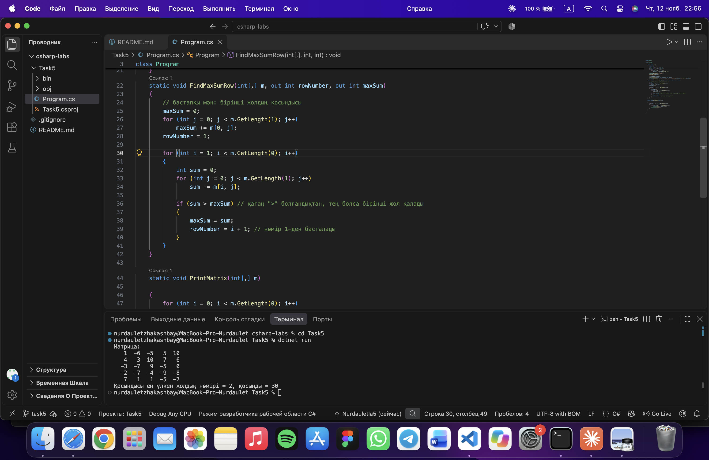

# 5-тапсырма: Екі өлшемді массивтер (нұсқа 4)

| Тест | Кіріс | Қолмен есептеген жауап | Бағдарлама жауабы |
|---|---|---|---|
| Жеке тест | Random(15) | 2-жол, қосынды 30 (4+3+10+7+6) | 2-жол, қосынды 30 |

| Өз тестім 1 | барлық элемент 1 | 1-жол, қосынды 5 | 1-жол, қосынды 5 | 
[нәтиже](screenshot2.png)

| Өз тестім 2 | 4-жол толығымен -1, қалғандары -5 | 4-жол, қосынды -5 | 4-жол, қосынды -5 | 
[нәтиже](screenshot3.png)

## Сұрақтарға жауап

1) matrix[i, j] жазбасында i — жол нөмірі, j — баған нөмірі. GetLength(0) жолдар санын, GetLength(1) бағандар санын қайтарады, менің матрицамда екеуі де 5.

2) Бастапқы мәнді 0 деп алсам, барлық жолдың қосындысы теріс болғанда ешбір қосынды 0-ден үлкен болмас еді де, нәтиже қате болар еді. Сондықтан бірінші жолдың қосындысынан бастаймын. Мұны 2-тестте тексердім, онда барлық қосынды теріс.

3) Қосындыны есептейтін ішкі цикл 5 жол × 5 баған = 25 рет орындалады: бірінші жол үшін 5 және қалған 4 жол үшін 4 × 5 = 20.

## ЖИ қолдану

қолдандым