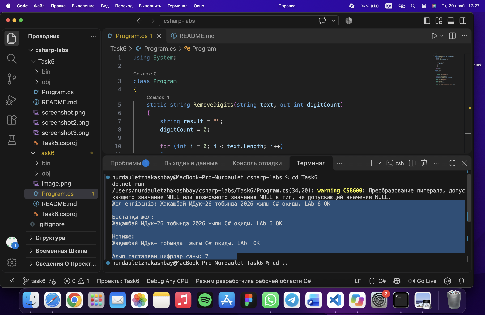
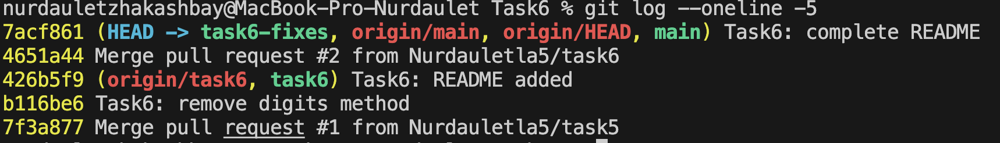

# 6-тапсырма: Символдар тіркесі (нұсқа 2)

| Тест | Кіріс | Қолмен есептеген жауап | Бағдарлама жауабы |
|------|--------|---------|---------|
| Жеке тест | Теңіз ИС-21 тобында 2026 жылы C# оқиды. Lab 6 OK | 7 цифр жойылады | Дұрыс |
| Өз тестім 1 | abc123 | abc, 3 цифр | abc |
| Өз тестім 2 | 555aaa | aaa, 3 цифр | aaa |

## Сұрақтарға жауап

### 1
text[i] жолдың i-индексіндегі символды қайтарады. Оның типі char. String өзгермейтін болғандықтан text[i] арқылы символды өзгертуге болмайды.

### 2
Символдың цифр екенін char.IsDigit() әдісі арқылы тексердім. '5' символ болып табылады, ал 5 бүтін сан болып табылады.

### 3
result += ch орындалғанда жаңа string объектісі құрылады. Ескі жол өзгермейді.

## Кездескен қате

Қате:
The name 'count' does not exist in the current context.

Қалай түзеттім:
Айнымалыны out параметрі арқылы қайтардым.

Түзеткен коммит:

## Git

git log --oneline --graph --all командасының нәтижесін осында орналастырамын.

1. task6 тармағында жасалған өзгерістер merge арқылы main тармағына енгізілді. Біріктірілгеннен кейін task6 тармағы сақталып қалды.

2. Commit өзгерістерді жергілікті компьютерде сақтайды, ал push оларды GitHub-қа жібереді.

3. .gitignore файлы қажет емес файлдарды бақылаудан шығарады. bin және obj қалталары автоматты түрде құрылатындықтан репозиторийге қосылмайды.

## ЖИ қолдану

Copilot/ChatGPT арқылы тапсырманың шешімін талдап, кодтың дұрыс құрылуын тексердім. Кодты өзім енгізіп, бейімдедім.

